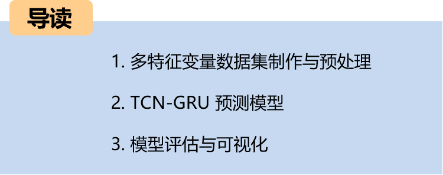
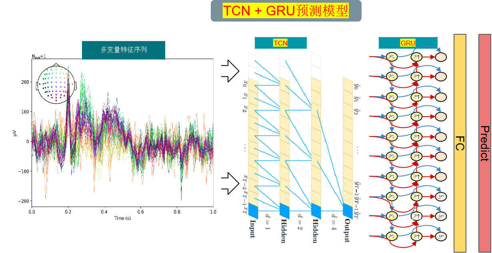
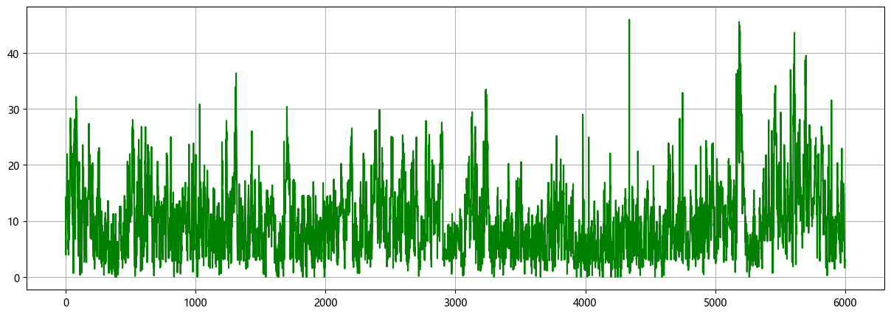
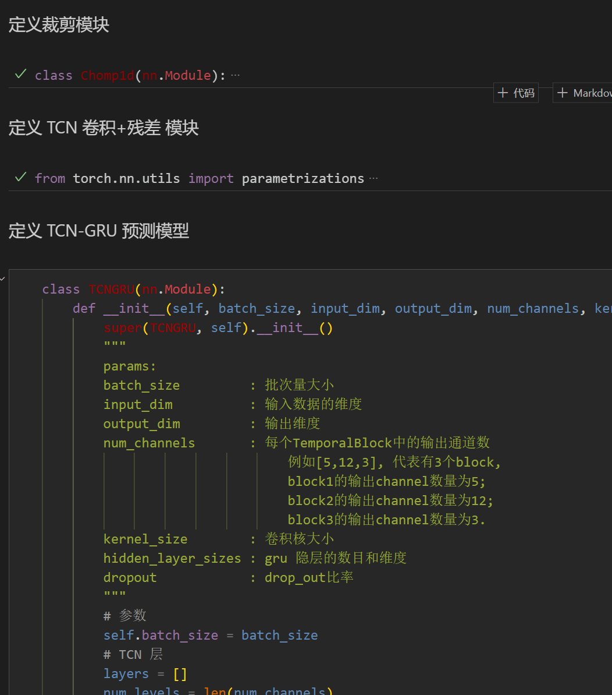
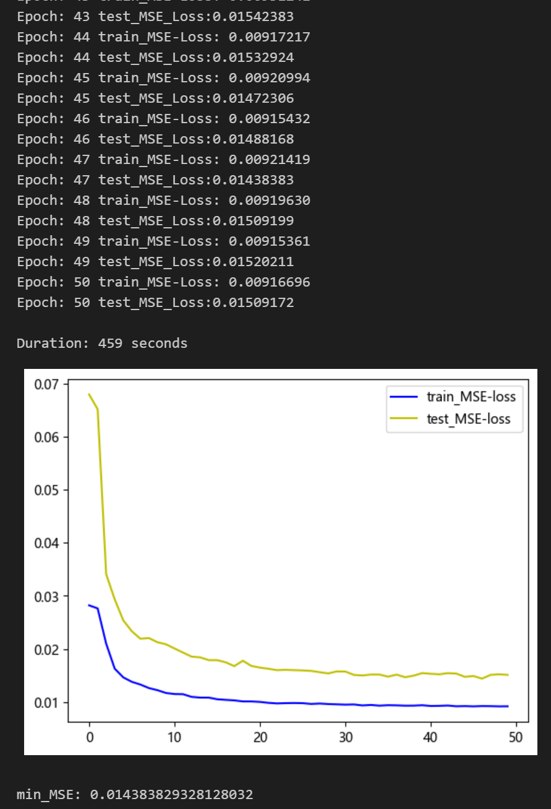
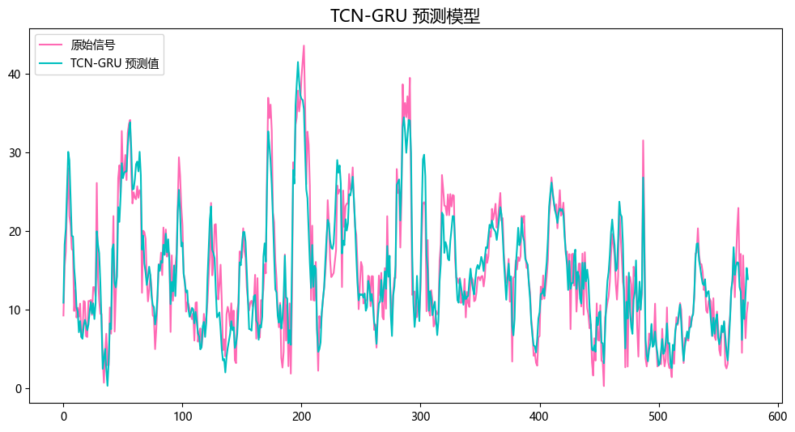
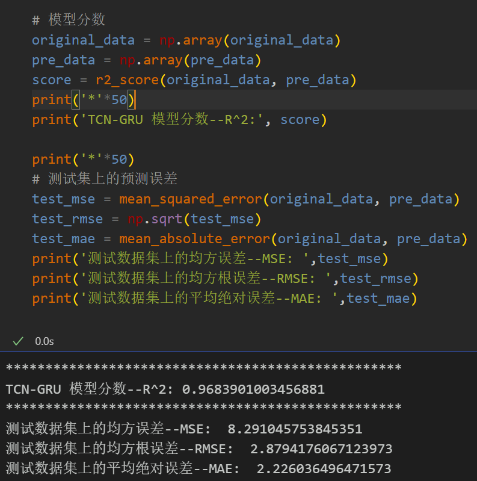
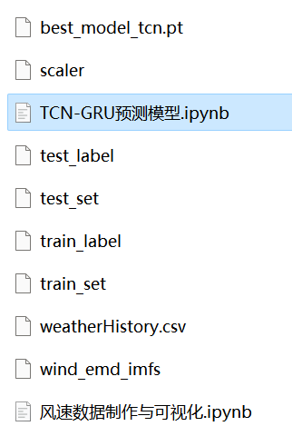

# Multi-feature Variable Sequence Prediction (11) TCN-GRU Prediction Model Based on Pytorch

Single-variable includes the following content:
Including wind speed data, as well as a pre-generated dataset and label set for wind speed, with corresponding code that can be run.
TCN-GRU prediction model, with smaller MSE and MAE, showing significant improvement in performance!
Includes code for data preprocessing and complete TCN-GRU model prediction and visualization code.
Preface
This article introduces a multi-feature variable sequence prediction model based on the TCN-GRU network model, which is based on the previously introduced wind speed data (Appendix at the end of this document contains the dataset). The TCN-GRU model is a deep learning model that combines Temporal Convolutional Network (TCN) and Gated Recurrent Unit (GRU), used for time series prediction tasks. This model integrates the parallel computing capabilities of convolutional neural networks and the memory performance of recurrent neural networks, effectively capturing long-term dependencies in time series data to improve the predictive performance of time series data.
The overall structure of the model: The dataset consists of nine variables including weather, temperature, humidity, pressure, and wind speed. A sliding window is used to create the dataset, predicting wind speed using multiple variables. After extracting features through the TCN-GRU prediction model, they are then fed into a fully connected layer to achieve high-precision prediction models.
1. TCN (Temporal Convolutional Network) is a time series model based on convolutional neural networks. It uses one-dimensional convolution layers to capture local and global features in time series data. Through stacking multiple convolution layers and non-linear activation functions, TCN can effectively expand its receptive field and capture information at different time scales.
2. GRU (Gated Recurrent Unit) is a type of recurrent neural network unit used for processing sequence data. It employs a gating mechanism (gate units) to control the flow of information and update memory. By using forget gate, update gate, and reset gate, GRU can effectively capture long-term dependencies in sequence data and avoid problems such as vanishing gradients or exploding gradients.
3. The TCN-GRU prediction model combines TCN and GRU. Firstly, it extracts features and learns representation from time series data through the TCN layer. Then, the output of the TCN is used as input to the GRU, which utilizes the memory performance of GRU for further sequence modeling and prediction. It can perform efficient parallel computing, consume lower memory, handle long-term dependencies, and has some flexibility.
The detailed introduction to the wind speed dataset can be referred to the following text:
Wind Speed Prediction (Part I): Introduction and Preprocessing
1. Multi-feature variable dataset preparation and preprocessing
1.1 Import data
1.2 Dataset preparation and preprocessing
Firstly, divide the dataset into training set and test set according to a ratio of 9:1, then create the dataset
2. Based on Pytorch's TCN-GRU prediction model
2.1 Define the TCN prediction model
Note: The shape of the input wind speed data is [32, 7, 8], batch_size=32, where 7 represents the length of the sequence (the sliding window takes values), and the dimension of 8 represents the dimension of the selected 8 variables.
2.2 Set parameters and train the model
50 epochs, MSE is 0.01438, the multi-variable feature TCN-GRU prediction effect is good, with excellent performance. If necessary, adjust the model parameters to further improve the model prediction performance.
Note to adjust parameters:
Adjustable parameters include:
- Increase the number of TCN layers and the dimension of the hidden layer, fine-tuning the learning rate;
Adjust the number of GRU layers and the number of neurons per layer, increasing more epochs (note to prevent overfitting)
Change the sliding window length (set an appropriate window length)
3 Model Evaluation and Visualization
3.1 Results Visualization
3.2 Model Evaluation

## Images

<!-- PAYMENT_BLOCK -->

## Get this dataset

- Payment link (Stripe): [Buy now](https://buy.stripe.com/3cs8yP7sY87d0vu9AB)
- Payment QR code: 

<!-- /PAYMENT_BLOCK -->
